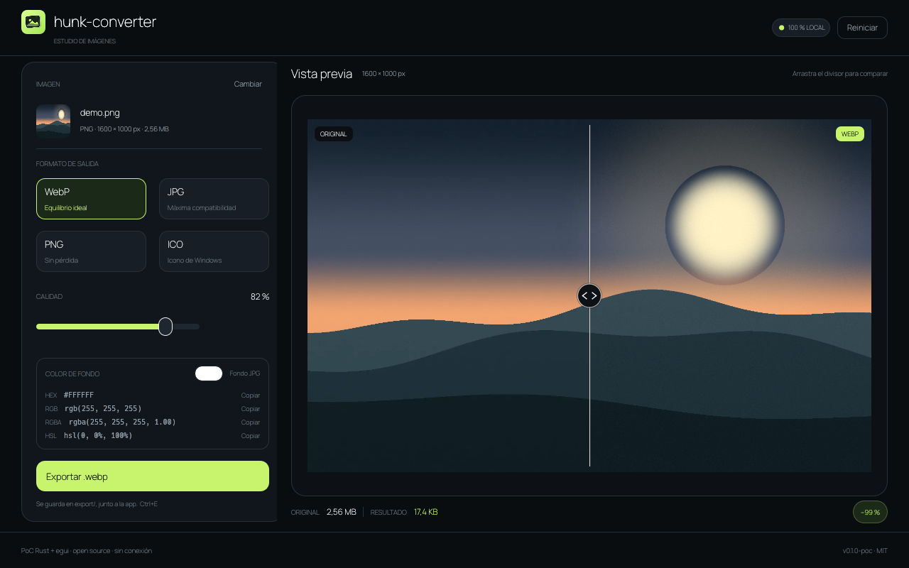

# hunk-converter — PoC Rust/egui

Prueba de concepto **independiente** del prototipo Godot. Su objetivo es medir si
Rust + egui permite conservar la experiencia y reducir de forma clara el consumo
de recursos antes de decidir una migración.



## Qué valida

- Ventana nativa con egui/eframe y renderizador OpenGL (glow).
- Arrastrar y soltar imágenes sobre la ventana.
- Carga de PNG, JPG, WebP, BMP y TGA.
- Codificación WebP, JPG, PNG e ICO multirresolución.
- Comparador deslizante antes/después con damero para transparencia.
- Procesamiento de imagen fuera del hilo de interfaz.
- Selector de color de fondo con códigos **HEX, RGB, RGBA y HSL** y copia al
  portapapeles. Se aplica al aplanar transparencias en JPG.
- Exportación directa a `export/`, junto al ejecutable, con nombres únicos.
- Atajos: `Ctrl+O`, `Ctrl+E` y `Ctrl+R`.

## Medidas de la prueba

Entorno: Debian 12, Rust 1.99.1, egui/eframe 0.37 y Godot 4.7.2,
renderizado por software con llvmpipe bajo Xvfb. Imagen sintética de
**4000 × 3000 px** (12 MP). Son cifras orientativas; el detalle y las condiciones
están en el [informe completo](docs/benchmark-2026-10-28.md).

| Métrica | Godot 0.1.0 | PoC Rust/egui | Diferencia |
| --- | ---: | ---: | ---: |
| Arranque a ventana (mediana) | 239,8 ms | 173,1 ms | **−27,8 %** |
| Binario Linux | 70,7 MiB | 7,5 MiB | **−89,4 %** |
| Ejecutable Windows | 104,7 MiB | 6,4 MiB | **−93,9 %** |
| RAM en reposo (RSS) | 209,7 MiB | 100,9 MiB | **−51,9 %** |
| RAM con imagen 12 MP | 316,9 MiB | 211,3 MiB | **−33,3 %** |
| Pico con GUI e imagen 12 MP | 447,5 MiB | 336,3 MiB | **−24,8 %** |
| WebP q82, 12 MP | 1121,0 ms / 88,9 KB | 743,9 ms / 78,7 KB | **−33,6 %** |
| JPG q82, 12 MP | 1137,0 ms / 604,7 KB | 380,8 ms / 700,9 KB | **−66,5 %** |
| PNG, 12 MP | 4723,4 ms / 12,24 MB | 3225,0 ms / 12,36 MB | **−31,7 %** |
| ICO 16–256, 12 MP | 723,9 ms / 43,2 KB | 448,8 ms / 43,1 KB | **−38,0 %** |
| CPU en reposo, 60 FPS software | ≈1130 % | **0 %** | actividad continua vs. bajo demanda |

La RAM en reposo se midió con las dos aplicaciones abiertas y sin imagen; la
cargada, con una imagen de 4000 × 3000. En ambos casos se usó el mismo servidor
Xvfb y llvmpipe, por lo que el consumo absoluto es mayor que con una GPU real.
La CPU se mide por proceso (100 % = un núcleo); el valor de Godot está inflado
por el renderizado software sin VSync y no debe extrapolarse a vatios reales.

Conclusiones provisionales:

- La mejora de tiempo en códecs va del 32 % al 66 % en 12 MP, pero no es un
  orden de magnitud: libwebp ya es nativo en ambos casos.
- La diferencia estructural está en **tamaño del ejecutable, arranque y memoria**.
- egui cubre sin problemas este tipo de interfaz: lienzo propio, arrastre, slider,
  drag & drop, selector de color y paneles.
- La migración solo tiene sentido si esos objetivos de huella son prioritarios.
  Si el objetivo principal fuera únicamente convertir más rápido, habría que
  optimizar códecs y paralelismo antes que cambiar de toolkit.

## Ejecutar

Requisitos: Rust 1.99.1 (fijado en `rust-toolchain.toml`), un compilador de C para `libwebp-sys` y, en
Linux, las bibliotecas gráficas de X11/Wayland habituales. En Windows hace falta
MSVC Build Tools o un toolchain GNU.

```bash
cargo run --release -- /ruta/a/imagen.jpg
# o abre la ventana y arrastra una imagen
cargo run --release
```

Para generar las capturas de documentación:

```bash
HUNK_POC_DEMO=1 HUNK_POC_SCREENSHOT=docs/hunk-converter-rust-poc.png \
  cargo run --release
```

Para probar la vista ICO:

```bash
HUNK_POC_DEMO=1 HUNK_POC_FORMAT=ico \
  HUNK_POC_SCREENSHOT=docs/hunk-converter-rust-poc-ico.png \
  cargo run --release
```

## Benchmark

```bash
cargo run --release --bin make_demo -- /tmp/muestra.png 4000 3000
cargo run --release --bin bench -- /tmp/muestra.png
```

El benchmark imprime el tiempo de cada formato, el tamaño resultante y el pico
de memoria (`VmHWM`) del proceso.

## Pruebas

```bash
cargo test
```

Cubre codificación de los cuatro formatos, calidad frente a tamaño,
transparencia PNG, aplanado JPG, estructura y frames ICO, y conversiones de
color.

## Limitaciones del piloto

- No incluye SVG.
- No respeta orientación EXIF.
- No conserva metadatos ni perfiles ICC.
- No incluye AVIF, HEIC ni JPEG XL; están registrados en `../Prototipo/todo.md`.
- No tiene accesibilidad nativa completa.
- La lectura de la imagen inicial ocurre en el hilo de interfaz.
- La ventana mínima es 1024 × 800.
- Aún no hay build Windows de esta PoC ni empaquetado final.
- El tema y la composición buscan validar la viabilidad, no copiar píxel a píxel
  el prototipo Godot.

El prototipo Godot sigue siendo la versión de referencia hasta que se decida la
migración definitiva.

## Documentación y contexto

- `retomar.md`: estado y comandos para retomar el piloto.
- `docs/benchmark-2026-10-28.md`: informe completo de rendimiento, memoria, arranque y empaquetado.
- `notes/`: evidencia fechada de la sesión.
- `../Prototipo/`: prototipo Godot de referencia y documentación del producto.

## Licencia

Código bajo [MIT](LICENSE). La tipografía Manrope se distribuye bajo la SIL Open
Font License 1.1; su licencia está incluida en
[assets/fonts/OFL.txt](assets/fonts/OFL.txt).

## Builds portables

En `dist/` se generan carpetas autocontenidas con el ejecutable, `export/`,
licencias y `LEEME.txt`:

```text
hunk-converter-piloto-0.1.0-windows-x86_64/
├── hunk-converter-piloto.exe
├── export/
├── LEEME.txt
├── LICENSE.txt
└── LICENCIAS/Manrope-OFL.txt
```

```bash
./scripts/build_dist.sh linux
./scripts/build_dist.sh windows
./scripts/build_dist.sh all
```

- Linux: binario nativo. La build de esta sesión está en
  `dist/hunk-converter-piloto-0.1.0-linux-x86_64.tar.gz`.
- Windows: por defecto compila para `x86_64-pc-windows-gnu`. Requiere el target
  de Rust y un toolchain de enlazado adecuado. La build de esta sesión está en
  `dist/hunk-converter-piloto-0.1.0-windows-x86_64.zip`.
- La build Linux se ejecutó y exportó correctamente junto a su binario. La build
  Windows se generó, pero no se ejecutó en un Windows real en esta sesión.
