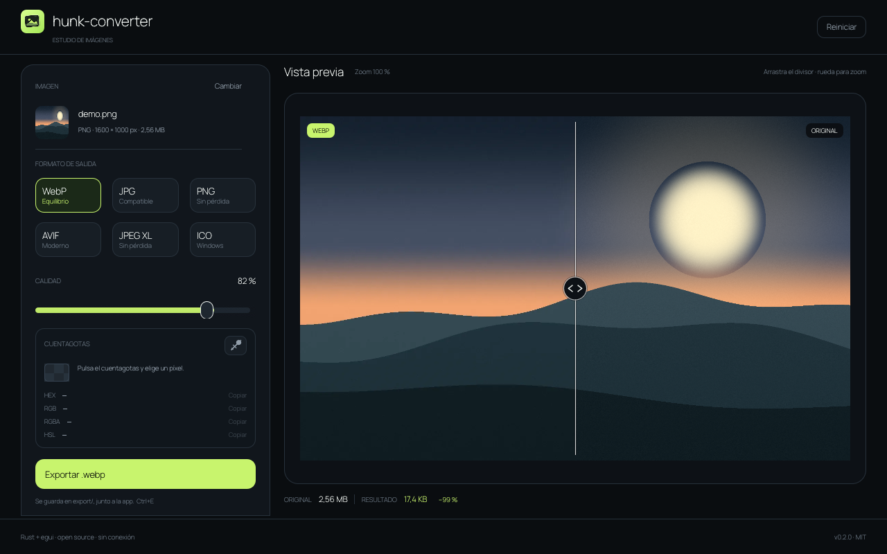
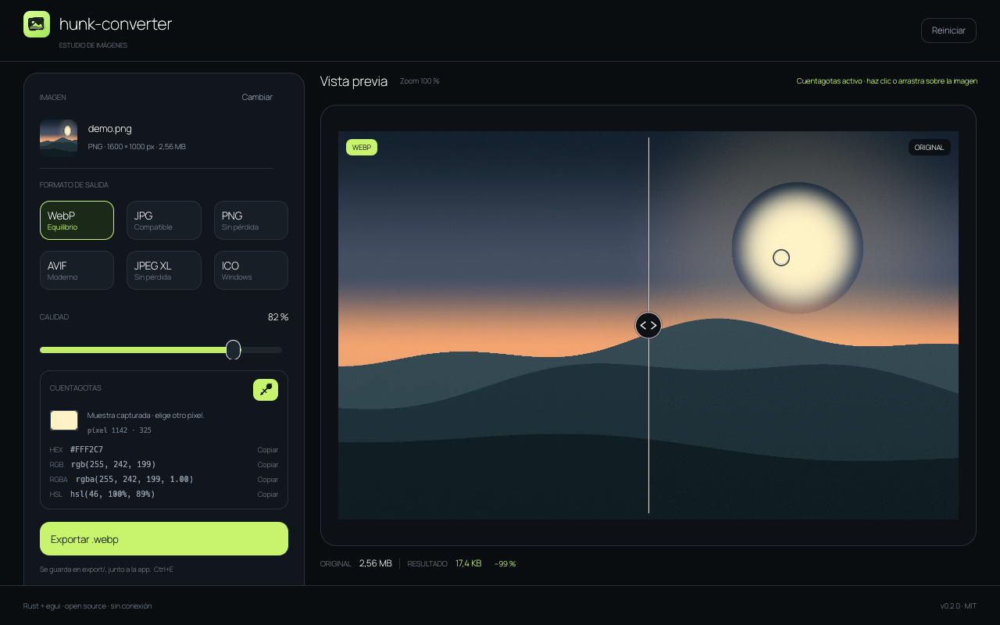
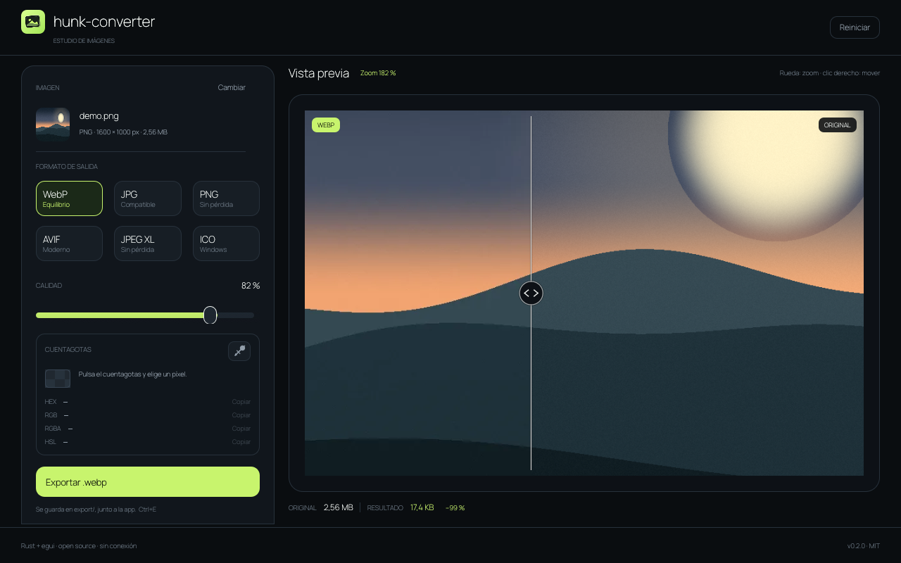
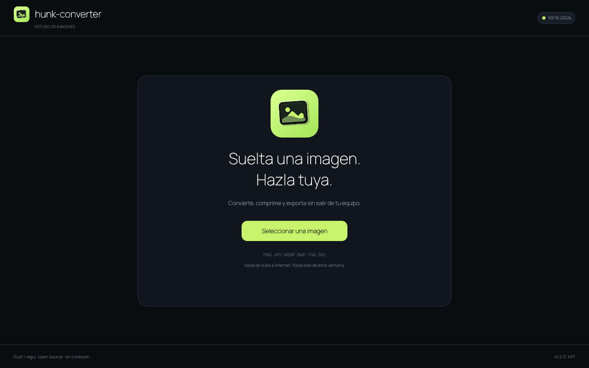
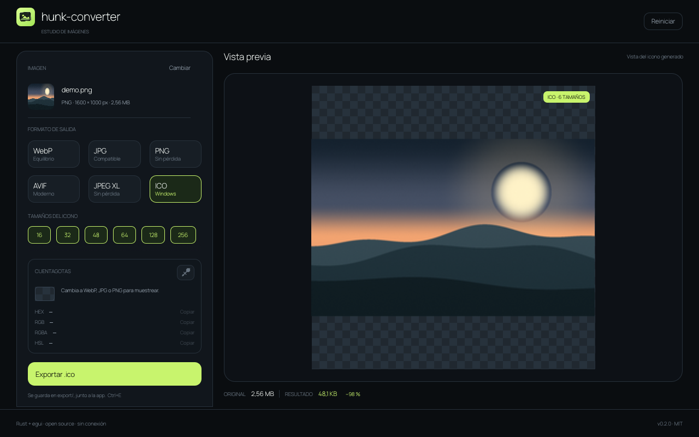

# hunk-converter

**Convierte, comprime, compara, muestrea colores y exporta imágenes sin salir de tu equipo.**

hunk-converter es una aplicación de escritorio local-first escrita en **Rust + egui**. Arrastra una imagen, elige el formato de salida, ajusta la calidad y comprueba el resultado real con un comparador deslizante antes de guardarlo. También genera iconos `.ico` multirresolución.

La interfaz solo repinta cuando hay actividad. No mantiene un bucle de render continuo mientras miras una imagen estática.

Todo el procesamiento ocurre en tu ordenador: no hay cuentas, subidas ni conexión a internet.



## Características

- **Arrastrar y soltar** en cualquier parte de la ventana, o selector nativo con `Ctrl+O`.
- **Pegar desde el portapapeles** con `Ctrl+V`, haya o no una imagen cargada.
- **Entrada:** PNG, JPG/JPEG, WebP, BMP, TGA y SVG.
- **Salida:** WebP, AVIF, JPG, PNG, JPEG XL e ICO.
- **Calidad ajustable** de 1 a 100 para WebP, JPG y AVIF (82 % por defecto).
- **Comparador visual** antes/después con divisor arrastrable y soporte de teclado.
- **Zoom y paneo:** rueda del ratón sobre la imagen y clic derecho para desplazarte.
- **Vista previa fiel al archivo final**: se decodifica el resultado codificado real.
- **Cuentagotas:** pulsa el icono y haz clic o arrastra sobre la imagen para capturar un color.
- **Códigos simultáneos:** HEX, RGB, RGBA y HSL, con copia al portapapeles.
- **Exportación ICO** con selección de 16, 32, 48, 64, 128 y 256 px en un solo archivo.
- **PNG y JPEG XL sin pérdida**, con transparencia conservada en WebP/AVIF/PNG/JPEG XL/ICO.
- **JPG sobre fondo blanco** cuando la imagen tiene transparencia.
- **Guardado directo** en `export/`, junto al ejecutable, sin sobrescribir archivos.
- **Reinicio completo** con `Ctrl+R`.
- **Portable:** builds de Linux y Windows, sin instalador.
- **Local y privado:** cero llamadas de red.
- **Render bajo demanda:** sin CPU de UI en reposo.

## Cuentagotas

1. Carga una imagen.
2. Pulsa el **icono de cuentagotas** en la tarjeta inferior.
3. Haz clic sobre la imagen o arrastra desde el icono hasta el píxel que quieras.
4. Copia cualquiera de sus códigos de color.

El icono vuelve a pulsarse para desactivar el modo. También puedes cancelarlo con `Esc`. La marca de muestreo solo se muestra mientras el cuentagotas está activo.

La muestra se toma del píxel original, no del resultado recompimido, y conserva el canal alfa. En la vista ICO el cuentagotas se desactiva porque esa vista representa el icono generado, no la imagen de origen.



## Zoom y navegación

- **Rueda del ratón** sobre la imagen: acerca y aleja manteniendo el punto bajo el cursor.
- **Clic derecho y arrastra**: desplaza la imagen cuando está ampliada.
- El porcentaje de zoom aparece en la cabecera de la vista previa; pulsa sobre él para volver al ajuste inicial.
- El divisor y el cuentagotas siguen funcionando con cualquier zoom.



## Capturas

| Inicio | Vista ICO |
| --- | --- |
|  |  |

Las capturas usan imágenes de muestra generadas por el propio proyecto.

## Ejecutar desde el código

Requisitos:

- **Rust 1.99.1** (fijado en `rust-toolchain.toml`).
- Un compilador de C para `libwebp-sys`.
- **NASM** en x86/x86_64 para el decodificador AVIF (`rav1d`).
- En Linux, las bibliotecas gráficas habituales de X11/OpenGL.
- En Windows, MSVC Build Tools o un toolchain GNU.

```bash
cargo run --release -- /ruta/a/imagen.jpg
# o abre la ventana y arrastra una imagen
cargo run --release
```

## Uso

1. Arrastra una imagen a la ventana, pulsa **Seleccionar una imagen** o usa `Ctrl+V`.
2. Elige **WebP**, **JPG**, **PNG** o **ICO**.
3. Ajusta la calidad o los tamaños del icono.
4. Arrastra el divisor para comparar. Usa la rueda para acercar y el clic derecho para moverte por la imagen.
5. Activa el cuentagotas si necesitas extraer colores.
6. Pulsa **Exportar** o `Ctrl+E`.

El archivo aparece en `export/`, junto a la aplicación. Si el nombre existe, se añade `-2`, `-3`, etc.

### Atajos

| Atajo | Acción |
| --- | --- |
| `Ctrl+O` | Abrir imagen |
| `Ctrl+V` | Pegar una imagen del portapapeles |
| `Ctrl+E` | Exportar |
| `Ctrl+R` | Reiniciar la aplicación |
| `←` / `→` | Mover el divisor del comparador |
| `Inicio` / `Fin` | Llevar el divisor a un extremo |

## Formatos

| Formato | Entrada | Salida | Transparencia | Calidad |
| --- | :---: | :---: | :---: | :---: |
| WebP | ✓ | ✓ | Sí | 1–100 |
| AVIF | — | ✓ | Sí | 1–100 |
| JPG / JPEG | ✓ | ✓ | No (fondo blanco) | 1–100 |
| PNG | ✓ | ✓ | Sí | Sin pérdida |
| JPEG XL | — | ✓ | Sí | Sin pérdida |
| ICO | — | ✓ | Sí | Tamaños fijos |
| BMP | ✓ | — | Según archivo | — |
| TGA | ✓ | — | Según archivo | — |
| SVG | ✓ | — | Rasterizado | — |

Los SVG se rasterizan con `resvg` al tamaño declarado. AVIF y JPEG XL se añaden como formatos de salida; JPEG XL se codifica sin pérdida. PNG y JPEG XL no muestran deslizador porque no modifican la calidad de la imagen. El límite de entrada es de 200 MB y 40 megapíxeles (máximo 16 384 px por lado).

## Builds portables

Cada build es una carpeta autocontenida. La salida queda en `export/`, junto al ejecutable.

```text
hunk-converter-0.2.0-windows-x86_64/
├── hunk-converter.exe
├── export/
├── LEEME.txt
├── LICENSE.txt
└── LICENCIAS/
    └── Manrope-OFL.txt
```

```bash
./scripts/build_dist.sh linux
./scripts/build_dist.sh windows
./scripts/build_dist.sh all
```

Los resultados se generan en `dist/`:

- Linux: carpeta y `.tar.gz`.
- Windows: carpeta y `.zip` si `zip` está instalado.

La build Windows se ha generado, pero todavía no se ha ejecutado en un Windows real. La build Linux se validó bajo X11, incluyendo la exportación a su carpeta `export/`.

## Pruebas

```bash
cargo test
cargo clippy --all-targets -- -D warnings
cargo fmt --all -- --check
```

La suite cubre codificación WebP/JPG/PNG/AVIF/JPEG XL, calidad, transparencia, aplanado JPG, estructura ICO, códigos de color, rasterización SVG y la zona de agarre del comparador. También se ejecuta en GitHub Actions.

## Rendimiento

La versión Rust/egui se comparó con el prototipo Godot antes de migrar. En el mismo entorno Linux y con la misma imagen, el binario, la memoria, el arranque y los tiempos de codificación son claramente menores. El informe completo, la metodología y las limitaciones están en:

[`docs/benchmark-2026-10-28.md`](docs/benchmark-2026-10-28.md)

## Estructura

```text
.
├── assets/                 Iconos, tipografía y licencias
├── docs/                   Capturas e informe de benchmark
├── notes/                  Evidencia fechada de las sesiones
├── scripts/build_dist.sh   Empaquetado portable
├── src/
│   ├── app.rs              Interfaz, estado, cuentagotas y exportación
│   ├── core/               Códecs, ICO y conversión de color
│   ├── bin/                Benchmark y generador de muestra
│   ├── demo.rs             Imagen sintética para capturas
│   └── theme.rs            Tema visual
├── proyecto.md             Documento vivo
├── todo.md                 Tareas pendientes
├── t-completadas.md        Tareas cerradas
└── retomar.md              Punto de entrada para nuevas sesiones
```

## Documentación

- [proyecto.md](proyecto.md) — producto, funcionalidad y arquitectura.
- [todo.md](todo.md) — tareas pendientes.
- [t-completadas.md](t-completadas.md) — tareas cerradas.
- [retomar.md](retomar.md) — estado y contexto para continuar.
- [notes/](notes/) — evidencia fechada.
- [docs/benchmark-2026-10-28.md](docs/benchmark-2026-10-28.md) — benchmark comparativo.

El prototipo Godot original se conserva como archivo histórico en `../Prototipo`.

## Licencia

Código bajo [MIT](LICENSE). La tipografía Manrope se distribuye bajo la SIL Open Font License 1.1; su licencia está incluida en [assets/fonts/OFL.txt](assets/fonts/OFL.txt).
